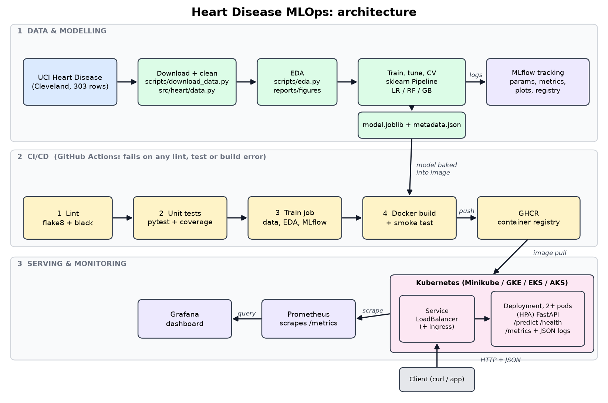

# Heart Disease Risk: End-to-End MLOps Pipeline

Predicts the presence of heart disease from 13 clinical features (UCI *Heart Disease*, Cleveland subset) and serves the model as a containerised, monitored FastAPI service, with experiment tracking (MLflow), CI/CD (GitHub Actions), Kubernetes deployment, and Prometheus/Grafana monitoring.


**Demo video:**  |  **Report:** `docs/report.docx`  |  **Deployed API:** local Kubernetes, see [Deploy](#6-deploy-to-kubernetes)



## Where to find each assignment item

| # | Task | Where |
|---|------|-------|
| 1 | Data acquisition and EDA | `scripts/download_data.py`, `src/heart/data.py`, `scripts/eda.py`, `notebooks/`, `reports/figures/eda/` |
| 2 | Features and models | `src/heart/features.py`, `src/heart/train.py` (LogReg, RandomForest, GradientBoosting; GridSearchCV; 5-fold CV) |
| 3 | Experiment tracking | MLflow in `src/heart/train.py` (`make mlflow-ui`) |
| 4 | Packaging and reproducibility | `models/model.joblib` (full pipeline), `models/model_metadata.json`, pinned `requirements*.txt` |
| 5 | CI/CD and tests | `tests/` (38 tests), `.github/workflows/ci.yml` |
| 6 | Containerisation | `Dockerfile`, `src/heart/api/` |
| 7 | Deployment | `k8s/` (Deployment, LoadBalancer Service, Ingress, HPA, kustomize) |
| 8 | Monitoring and logging | `/metrics`, JSON access logs, `k8s/monitoring/`, `monitoring/docker-compose.yml` |
| 9 | Report | `scripts/build_report.py` generates `docs/report.*` from your run |

## Repository layout

```
src/heart/          config, data, features, train, predict, api/ (FastAPI)
scripts/            download_data, eda, load_test, draw_architecture, build_report
tests/              pytest suite (data, features, model, API)
k8s/                Kubernetes manifests + monitoring/ (Prometheus, Grafana, dashboard JSON)
monitoring/         docker-compose stack for local Prometheus + Grafana
.github/workflows/  ci.yml
notebooks/          interactive EDA / modelling / inference walkthrough
data/processed/     heart_clean.csv (created by the download script; commit it)
models/             model.joblib + model_metadata.json (created by training; commit them)
docs/               report, architecture diagram, screenshots/, video_script.md
```

## 1. Setup

```bash
python -m venv .venv && source .venv/bin/activate      # Windows: .venv\Scripts\activate
make install                                           # or: pip install -r requirements-dev.txt && pip install -e .
```

Python 3.12 is what CI and the Docker image use (3.13 also works). All versions are pinned.

## 2. Data, EDA, training

```bash
make data     # downloads processed.cleveland.data from UCI -> data/processed/heart_clean.csv
make eda      # figures -> reports/figures/eda/
make train    # GridSearchCV + CV + MLflow tracking -> models/model.joblib
make mlflow-ui   # http://localhost:5000
```

No internet on the machine? Download the dataset zip manually from <https://archive.ics.uci.edu/dataset/45/heart+disease>, put `processed.cleveland.data` into `data/raw/`, then run `python scripts/download_data.py --skip-download`.

**Method summary.** Preprocessing lives inside a single scikit-learn `Pipeline` (median/most-frequent imputation, scaling, one-hot encoding, three engineered clinical features). Four candidates are tuned with 5-fold stratified `GridSearchCV` (ROC-AUC) on the training split; the model with the best cross-validated ROC-AUC is selected and scored once on a held-out 20% test set. An ablation (`logreg_baseline`) shows whether the engineered features help. Every run logs parameters, CV and test metrics, ROC / confusion / importance plots and the model with its signature.

## 3. Tests and lint

```bash
make test     # pytest + coverage
make lint     # flake8 + black --check
```

## 4. Run the API

```bash
make run      # http://localhost:8000/docs
```

```bash
curl -X POST http://localhost:8000/predict -H "Content-Type: application/json" -d '{
  "age": 63, "sex": 1, "cp": 4, "trestbps": 145, "chol": 233, "fbs": 1, "restecg": 2,
  "thalach": 150, "exang": 0, "oldpeak": 2.3, "slope": 3, "ca": 0, "thal": 6 }'
```

```json
{"prediction": 1, "label": "disease", "confidence": 0.87, "probability_disease": 0.87,
 "risk_band": "high", "model_name": "...", "model_version": "..."}
```

Other endpoints: `POST /predict/batch`, `GET /health`, `GET /metrics`, `GET /docs`. Invalid input returns HTTP 422. `ca` and `thal` are optional.

## 5. Docker

```bash
make docker-build         # requires models/model.joblib from `make train`
make docker-run           # http://localhost:8000
```

Local monitoring stack (API + Prometheus + Grafana): `make monitor-up`, then Grafana at <http://localhost:3000> (admin / admin), dashboard **MLOps > Heart Disease API**. Generate traffic with `make load-test`.

## 6. Deploy to Kubernetes

Minikube example (Docker Desktop Kubernetes works the same, no tunnel needed):

```bash
minikube start
eval $(minikube docker-env)            # build straight into the cluster's Docker
make docker-build
make k8s-deploy                        # API (2 replicas) + HPA + Prometheus + Grafana
make k8s-status
minikube tunnel                        # second terminal: gives the LoadBalancer an address
curl http://127.0.0.1/health
kubectl -n heart-mlops port-forward svc/grafana 3000:3000      # dashboard
kubectl -n heart-mlops port-forward svc/prometheus 9090:9090   # targets page
```

Using the registry image instead (pushed by CI to GHCR): in `k8s/deployment.yaml` set
`image: ghcr.io/<your-github-user>/heart-disease-api:latest` (make the package public or add an image pull secret). On GKE/EKS/AKS the `LoadBalancer` service receives a public IP automatically.

Optional Ingress: `minikube addons enable ingress && kubectl apply -f k8s/ingress.yaml`, then `curl -H "Host: heart.local" http://$(minikube ip)/health`.

Remove everything: `make k8s-delete`.

## 7. CI/CD

`.github/workflows/ci.yml` runs on every push / PR: **lint > unit tests (coverage gate 80%) > data + EDA + training > Docker build, run and smoke test** (image pushed to GHCR on `main`). It fails on any lint, test or build error; reports, model, MLflow store, JUnit and container logs are uploaded as artifacts.

## 8. Report and screenshots

1. Take the screenshots listed in `docs/screenshots/CHECKLIST.md`.
2. `make report` (or `python scripts/build_report.py --author "..." --student-id "..." --repo-url ... --formats docx pdf`). All numbers and figures come from your own run.

## Troubleshooting

| Symptom | Fix |
|---|---|
| `FileNotFoundError: models/model.joblib` when building the image | run `make train` first |
| API returns 503 on `/predict` | model file missing at `MODEL_PATH`; check `/health` |
| `ImagePullBackOff` on Minikube | build inside the cluster Docker (`eval $(minikube docker-env)`) and keep `imagePullPolicy: IfNotPresent` |
| `EXTERNAL-IP <pending>` | start `minikube tunnel` |
| Grafana panels empty | send traffic (`make load-test`) and wait about 15 s |
